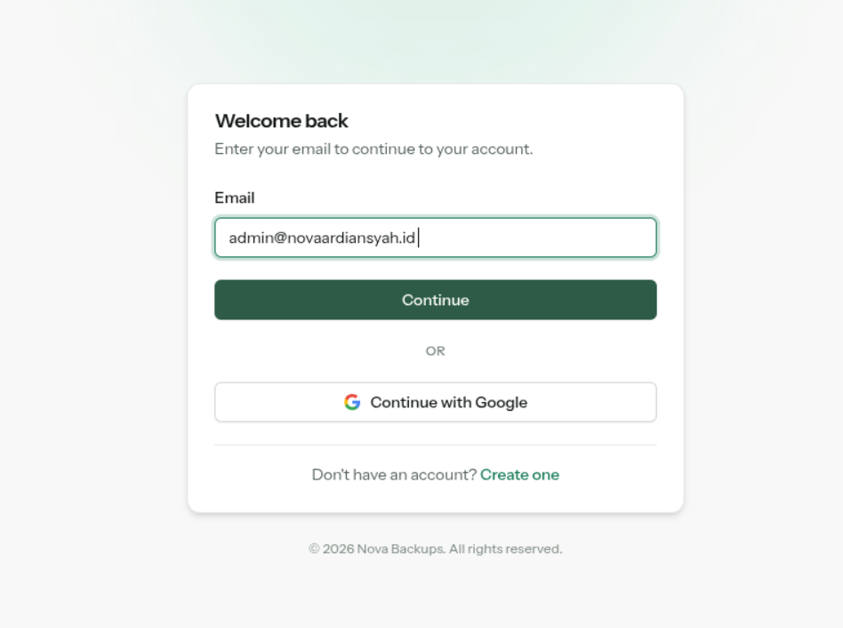
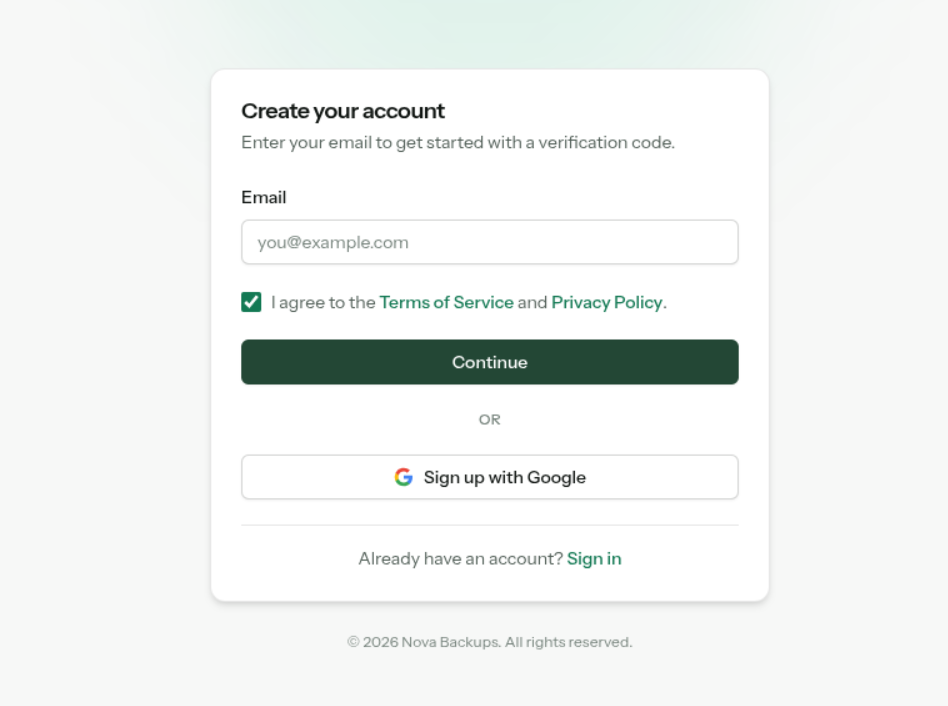
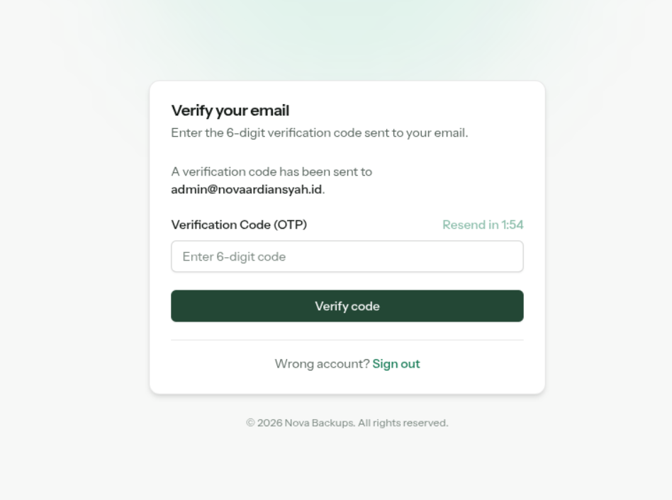
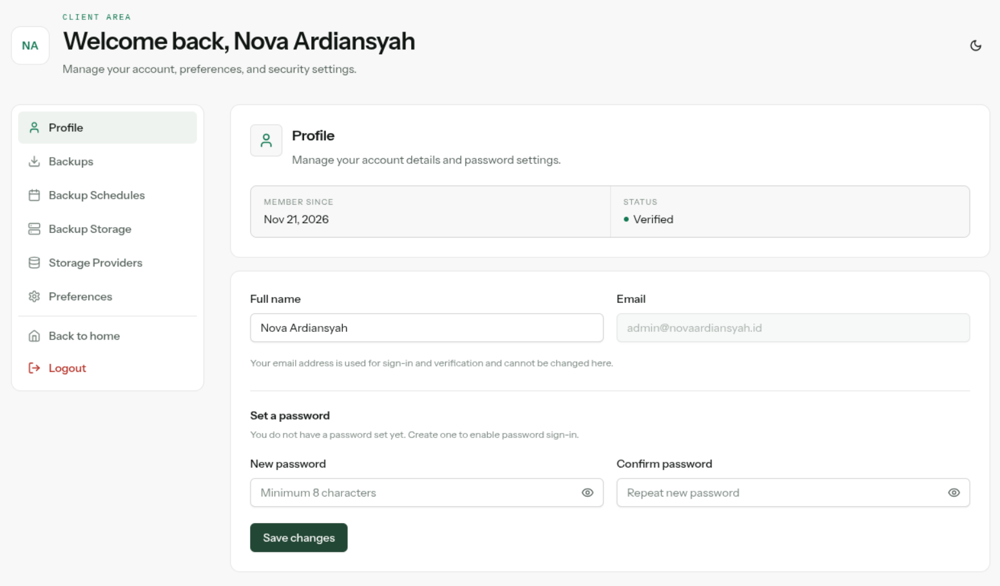
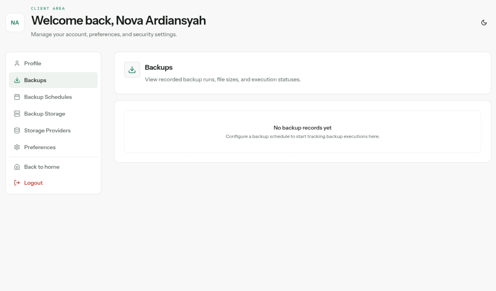
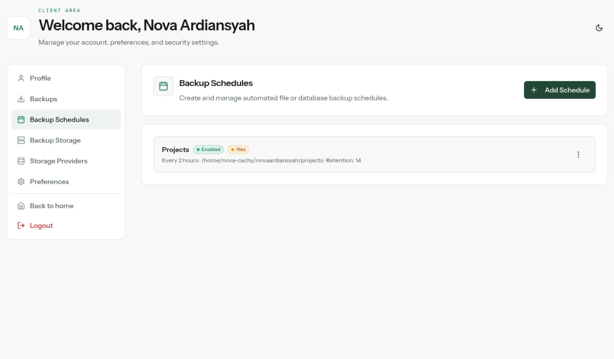
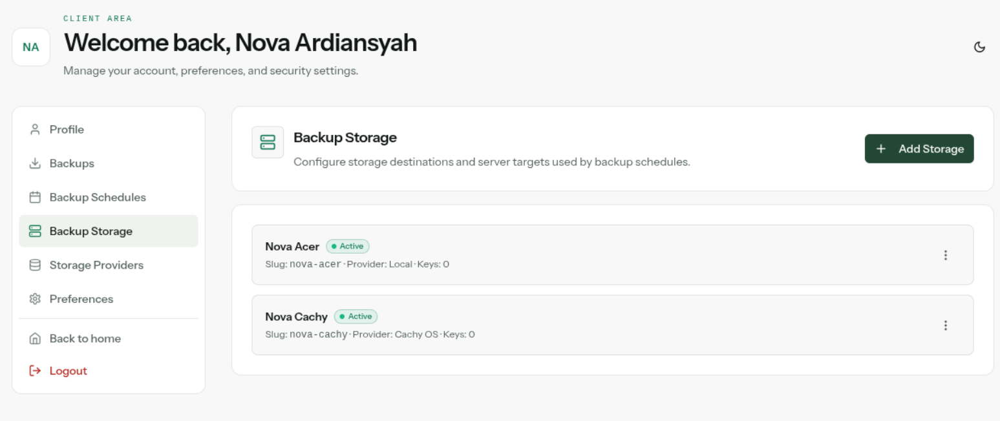
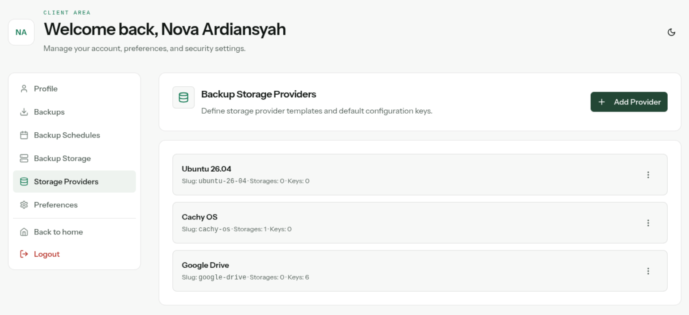
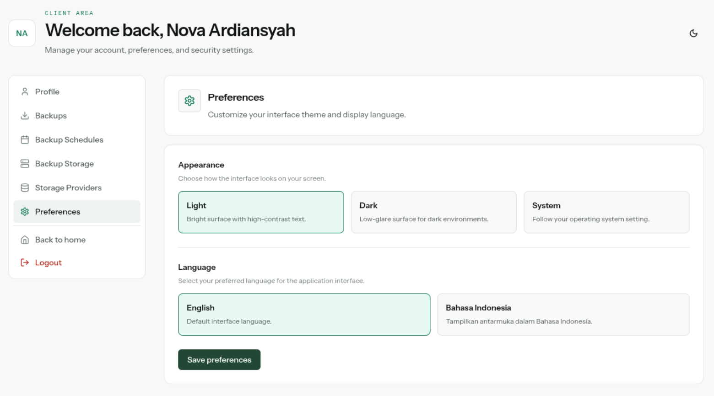

# Nova Backups Panel

Hi Future Developer,

Welcome to **Nova Backups Panel**, a modern web management interface built with **Laravel 13**, **Inertia.js v3**, and **Svelte 5** for organizing backup schedules, storage destinations, and cloud storage providers. It serves as the central control plane where you define what needs to be backed up, how often it runs, and where archives should be stored ready to be picked up and executed by your **Backup Agent** system.

Nova Backups Panel is designed for developers and system administrators who want a clean, calm workspace to manage automated file and database backups without wrestling with scattered config files. Once a backup run is executed by the agent, archives can be retained locally or uploaded directly to cloud storage destinations such as **Amazon S3 / S3-compatible storage** or **Google Drive**.

> **Note:** Nova Backups Panel acts as the management UI and schedule/storage registry. Actual archive creation, compression, retention pruning, and cloud uploads (e.g., S3 Storage or Google Drive) are carried out by the companion Backup Agent reading the configured schedules and storage targets.

---

## Screenshots

Every screenshot below illustrates Nova Backups Panel running live across authentication, email verification, backup management, storage configuration, and user preferences.

### Passwordless & Password Authentication

Sign in cleanly with your email and password or request a one-time verification code (OTP) delivered to your inbox.

### Account Registration

Create a new account with email verification and guided onboarding to set up your workspace quickly.

### Email Verification with OTP

Verify new accounts using a time-limited 6-digit OTP code with rate-limited resend support.

### Manage Profile & Account Security

Update your display name and configure or rotate your account password from the Profile panel, while keeping your sign-in email clearly displayed.

### Monitor Backup Executions

Review recorded backup runs with execution status badges (`success`, `failed`, `pending`), backup type tags (`files`, `database`, `full`, `incremental`), file sizes, timestamps, and contextual actions.

### Configure Automated Backup Schedules

Define file or database backup schedules with custom filename patterns, include/exclude paths, database drivers, intervals, retention counts, and local or cloud sync destinations plus a read-only **Detail** dialog with one-click `UID` copy.

### Manage Backup Storage Targets

Configure storage destinations linked to your providers, toggle active/inactive status, and manage destination-specific credentials and keys.

### Define Storage Providers

Register reusable storage provider templates (such as **S3 Storage** or **Google Drive**) along with their required configuration key-value pairs, accessible via right-click context menus or icon action buttons.

### Personalize Themes & Language

Switch seamlessly between **Light**, **Dark**, and **System** themes and toggle between **English (`en`)** and **Indonesian (`id`)** localization.

---

## Dazzling Tech Stack

- [Laravel 13](https://laravel.com/) - Backend framework, authentication, validation, and database persistence
- [Inertia.js v3](https://inertiajs.com/) - Modern monolith bridge connecting Laravel controllers with Svelte 5 pages
- [Svelte 5](https://svelte.dev/) - Reactive UI built with runes (`$state`, `$derived`, `$effect`)
- [TypeScript](https://www.typescriptlang.org/) - Strict frontend type checking via `svelte-check`
- [Tailwind CSS v4](https://tailwindcss.com/) - Semantic design tokens with light and dark theme support
- [Vite+](https://viteplus.dev/) - Fast frontend bundling and project checks
- [Laravel Wayfinder](https://github.com/laravel/wayfinder) - Typed route and controller action generation

---

## What You Can Do

- **Backup Schedule Management**: Create, inspect (`Detail`), edit, and delete automated schedules for **Files** (source path, include/exclude rules) or **Database** (`mysql`, etc.) with configurable intervals and retention limits.
- **Storage Providers & Destinations**: Define reusable provider templates (e.g., S3-compatible storage, Google Drive) and attach concrete storage destinations with custom key-value configurations.
- **Backup Execution Tracking**: View backup history with status badges, type badges, file sizes, timestamps, and right-click context menus.
- **Persistent URL Navigation & Actions**: Active tabs (`?tab=...`) and open dialogs (`?action=create|detail|edit|delete&id=<uuid_v7>`) are synchronized with URL query parameters so page refreshes preserve your exact view.
- **UUID v7 Public Identifiers**: Every table stores a generated UUID v7 `uid` for safe URL and UI identification while keeping numeric primary keys internal.
- **OTP & Password Authentication**: Supports email OTP sign-in, password sign-in, registration verification, and password resets.
- **Themes & Bilingual UI**: Supports Light, Dark, and System themes along with English and Indonesian interface translations.

---

## Good to Know

- **Control Plane Architecture**: This panel prepares and stores backup schedules, storage targets, and provider configurations; your external **Backup Agent** executes the jobs and uploads resulting archives to local paths or cloud providers like **S3 Storage** and **Google Drive**.
- **Contextual Actions Everywhere**: All backup tabs share consistent icon-only action buttons, right-click context menus, confirmation dialogs, and compact status badges.
- **Read-Only Schedule Inspection**: Use the **Detail** action on any schedule to review full source, retention, and cloud destination settings without risking accidental edits.

---

## Let's Connect

Need to chat? Feel free to drop me a line via [Email](mailto:novaardiansyah78@gmail.com) or hit me up on [WhatsApp](https://wa.me/6289506668480). I'm just a message away, ready to groove with you!

---

## Project Status

---

**Happy coding and collaborating!**  
- Nova Ardiansyah
